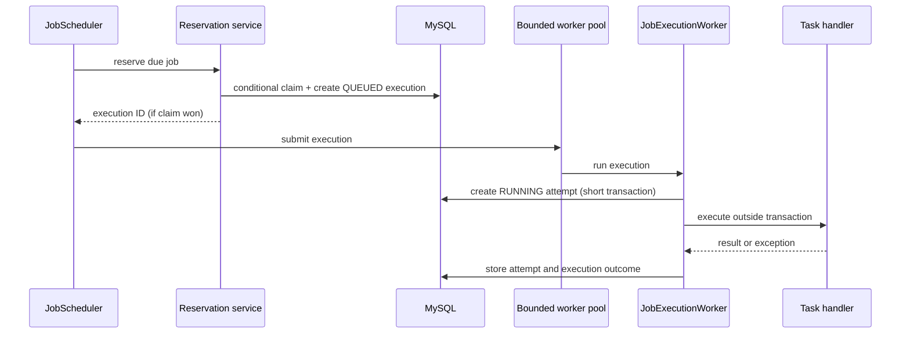
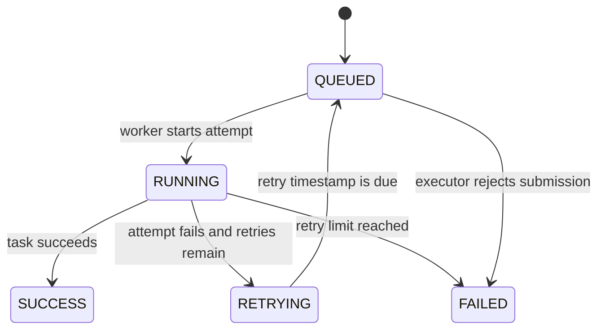

# JobFlow architecture

## Components

- **Controllers** validate and translate REST requests/responses. They do not return JPA entities.
- **JobService** validates schedules and handler configuration and manages job definitions.
- **JobScheduler** polls due jobs and retry timestamps; it dispatches but does not run task logic.
- **ExecutionReservationService** performs an atomic database claim and creates a queued execution.
- **ExecutionDispatchService** submits claimed work to the bounded worker pool and handles rejection.
- **JobExecutionWorker** calls the registered handler outside a database transaction.
- **JobExecutionService** records attempts, transitions execution state, applies retry policy, and raises alerts.
- **Repositories and entities** persist jobs, executions, attempts, and alerts.
- **TaskHandlerRegistry** maps the supported task enum to safe, controlled implementations.
- **AlertNotificationService** separates alert generation from delivery. The initial implementation logs the alert; a future email implementation can use the same interface.

## Execution lifecycle

The query selects enabled jobs with `next_run_at <= now`. A conditional update claims only an unlocked, still-due job, so concurrent scheduler polls cannot both claim the same job in this single-instance design. The next schedule time is advanced on claim; missed intervals are not replayed in a burst.

The worker pool has a configurable core size, maximum size, and bounded queue. A rejected submission is explicitly recorded as a failed execution and releases the job claim. Workers wait for active work during graceful shutdown.

## Retry lifecycle

`maxRetries` is the number of retries in addition to the first attempt. Each actual attempt has its own row and attempt number. Retry delay is `min(initialDelay * 2^(failedAttemptNumber - 1), maxDelay)`. The scheduler polls due retry timestamps; no thread sleeps for the backoff period.

Only final execution failure increments the job's consecutive-failure counter. On the transition to the configured threshold, one persisted alert is created. Further failures in the same streak do not create repeated threshold alerts. A successful execution resets the count.

## Recovery and limits

Execution and attempt status, attempt count, error summary, and `next_retry_at` are persisted in MySQL; recovery does not depend on in-memory queue state. At application-ready time, the scheduler:

1. Finds persisted `RUNNING` executions and closes every associated `RUNNING` attempt as interrupted.
2. Applies the normal retry limit and backoff policy to the interrupted execution. If no running attempt exists, it fails the execution and releases the job lock rather than guessing whether the work completed.
3. Resubmits persisted `QUEUED` executions.
4. Enables polling, which claims due `RETRYING` executions with a conditional update before dispatch.

This recovers work across application restarts without holding a transaction open around task execution. Due retry claims are persisted and conditional, preventing the same retry from being queued twice. Future retry timestamps remain persisted until due.

Recovery is at-least-once, not exactly-once: a process can stop after an external side effect succeeds but before success is persisted, and retry may repeat that side effect. `TaskContext.idempotencyKey()` provides a stable key for all attempts of one execution; handlers calling external systems should pass it to downstream idempotency support and reconcile ambiguous outcomes. Built-in handlers are simulations and do not perform external side effects. Recovery assumes a single application instance. Multiple instances need a distributed lease/fencing protocol to avoid one instance treating another instance's live attempt as interrupted.

All active executions for a job are serialized. Multiple application instances are not supported: the job claim is a local database conditional update, not a distributed lease/fencing protocol. Use a database-backed lock strategy appropriate to the target deployment before running multiple instances.

## Transaction boundaries

Transactions are short and cover claim plus queued execution creation, attempt start, or attempt completion. The task handler runs after the start transaction commits and before the completion transaction begins. This avoids holding database transactions or locks while arbitrary task work executes.
